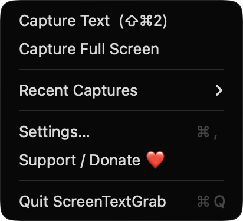
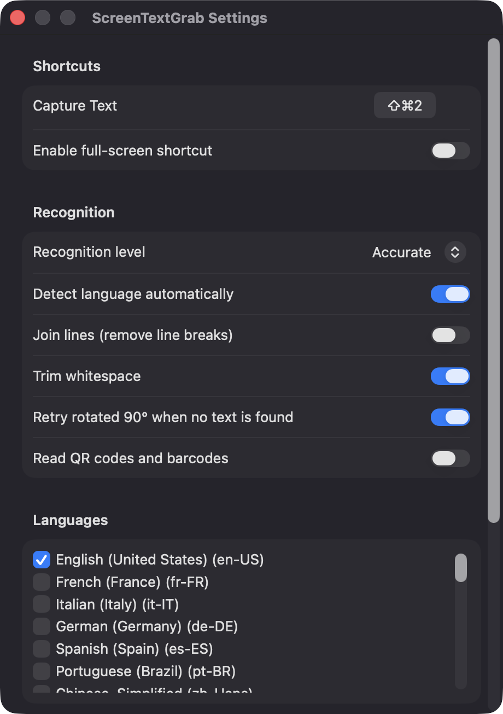
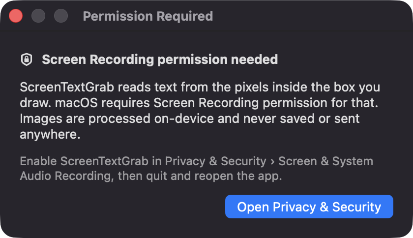

# ScreenTextGrab

**🌐 Website:** [turhe123.github.io/screen-text-grab](https://turhe123.github.io/screen-text-grab/)

**Drag a box over any pixels on screen and the recognized text lands on your clipboard.**

> 🆓 A free, open-source **TextSniper alternative** for macOS 14+. Native Swift, no accounts, no subscriptions, MIT licensed.


## Why

ScreenTextGrab is a free, open-source, 100% native, backend-free alternative to paid utilities in the *Menu Bar Utility* category. It was inspired by TextSniper ($9.99 one-time), which does this one job well; ScreenTextGrab aims to do the same job for everyone at no cost. Everything runs on-device with Apple's Vision framework: no servers, no accounts, no network calls, and no images written to disk.

## Features

- **Global hotkey capture**: press `⇧⌘2` (rebindable), drag a rectangle over any text, and the result is copied to the clipboard.
- **Full-screen capture**: optional second hotkey (`⇧⌘9` by default, off until enabled) or a menu item scans the entire main display.
- **On-device OCR** with Vision, with an *Accurate* or *Fast* recognition level.
- **Language selection**: pick from the languages your system's Vision revision supports, or let it detect the language automatically.
- **Text clean-up**: optionally join lines (remove line breaks) and trim whitespace. Results are ordered top-to-bottom, left-to-right.
- **Rotated text retry**: if nothing is found, the image is retried rotated 90°.
- **QR code and barcode mode** (optional): copies the payload of codes found in the selected region.
- **Recent Captures**: the last 20 captures are kept in memory only (never saved) and can be re-copied from the menu.
- **Feedback**: optional sound and a notification previewing the first line. If no text is found, you're told and the clipboard is left untouched.
- **Multi-display aware**: a selection overlay appears on every screen; Escape cancels, and so does switching Spaces. Selections smaller than 10 points are ignored.
- **Menu bar only**: no Dock icon. Optional launch at login.
- **Privacy**: captures are processed in memory and released; the app excludes its own windows from the capture.

## Screenshots

<p align="center"></p>

<p align="center"><em>The ScreenTextGrab menu bar menu with Capture Text (⇧⌘2), Capture Full Screen, Recent Captures, Settings and Support / Donate.</em></p>

<p align="center"></p>

<p align="center"><em>Settings for the capture shortcut, recognition level, line joining, whitespace trimming, rotated-text retry, QR/barcode reading and OCR languages.</em></p>

<p align="center"></p>

<p align="center"><em>A first-run window explains why Screen Recording permission is needed and that images are processed on-device and never saved.</em></p>

## Install

1. Download `ScreenTextGrab-macOS.zip` from the [latest release](https://github.com/turhe123/screen-text-grab/releases/latest).
2. Unzip it and move `ScreenTextGrab.app` to `/Applications`.
3. The app is open source and not notarized, so clear the quarantine flag:

   ```bash
   xattr -cr /Applications/ScreenTextGrab.app
   ```

4. The first time, right-click the app and choose **Open**.

Requires macOS 14.0 or later.

## Build from source

You need Xcode with the macOS SDK and [XcodeGen](https://github.com/yonaskolb/XcodeGen).

```bash
brew install xcodegen
xcodegen generate
xcodebuild -project ScreenTextGrab.xcodeproj -scheme ScreenTextGrab -configuration Release -derivedDataPath ./build build
```

The app is produced at `build/Build/Products/Release/ScreenTextGrab.app`.

## Permissions

| Permission | Required? | Why |
| --- | --- | --- |
| **Screen Recording** | Yes | macOS requires it to read pixels from the region you select (ScreenCaptureKit). On first capture the app shows an explanation window with a button to open Privacy & Security. After granting it, quit and reopen the app. |
| **Notifications** | Optional | Shows "Copied text" with a preview, or "No text found". Can be disabled in Settings. |

**Accessibility and Microphone are not requested.** Global shortcuts use the Carbon hot key API, which doesn't need Accessibility access, and the app never records audio.

## Built with AI

ScreenTextGrab was written by [Claude Code](https://claude.com/claude-code) inside an automated pipeline, from a plain-English spec. No code, binaries or assets from any commercial app were used; it is a clean-room reimplementation of a feature set, not a copy.

What that means in practice:

- The full source is in this repo under the MIT license. Read it before you run it.
- No network calls, no analytics, no third-party dependencies. Only Apple frameworks.
- Ad-hoc signed and not notarized, which is why Gatekeeper warns on first launch.
- It has had less human review than a hand-written app. Bug reports and pull requests are welcome.

## Support ❤️

ScreenTextGrab is free and open source. If it saves you time, you can support its development:

[Support Or (Leo) Davidai ❤️](https://ko-fi.com/leodavidai)

There is also a **Support / Donate ❤️** button in the menu and in Settings.

## More free Mac apps

ScreenTextGrab is one of a growing collection of [free, open-source Mac utilities](https://github.com/turhe123/mac-apps) built the same way: native Swift, no accounts, no telemetry. Browse the full gallery at [turhe123.github.io/mac-apps](https://turhe123.github.io/mac-apps/).

Prefer something that runs in the browser? The same pipeline builds [free, private web tools](https://turhe123.github.io/web-tools/): PDF, image, developer, data and audio tools, nothing uploaded.

## License

MIT © Or Davidai Bachar
